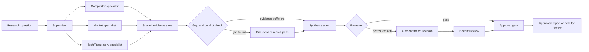

# Verified Market Research

A multi-agent research system that answers business and market questions using only research papers and formal reports. A supervisor agent splits each question across three specialist agents, their findings become a shared evidence store, and a reviewer agent checks the final report before it is approved. Every claim in the report links back to the source it came from.

Built by Team 2 at the Nittany AI Student Society (NAiSS), Penn State. Team 2 builds the multi-agent architecture; both teams produce the same ten-section report so the two architectures can be compared fairly.

## What it does

You ask a question such as *"How is NVIDIA positioning itself against AMD in the AI chip market?"* and the system:

1. Plans the research and assigns three non-overlapping objectives to specialist agents.
2. Searches peer-reviewed papers, government and regulatory documents, SEC filings, and analyst reports, never news, blogs, or social media.
3. Extracts dated, sourced facts into a shared evidence store.
4. Checks the evidence for gaps or contradictions, and runs one targeted extra search if needed.
5. Writes a ten-section report with an inline citation on every factual claim.
6. Reviews the report against six quality scores, allows one revision, and only approves it if every check passes.

## How it works



The pipeline is a [LangGraph](https://github.com/langchain-ai/langgraph) state graph. Each step is a node that reads and writes a shared state, and the loops are bounded on purpose: at most one extra research pass and at most one revision.

| Step | What it does |
| --- | --- |
| **Supervisor** | Divides the question into three distinct, search-ready objectives and validates that each role appears exactly once. |
| **Specialists** | Competitor, Market, and Tech/Regulatory agents run in parallel. Each searches approved sources and writes a short brief. |
| **Evidence store** | Turns every source into structured evidence records (claim, quote, source, date, source type, confidence), validates them, removes duplicates, and saves them to SQLite. |
| **Gap check** | Looks for one material gap or contradiction in the evidence. If it finds one, it reruns the supervisor and specialists on a narrower question and merges the new evidence. |
| **Synthesis** | Writes the report from the evidence only, citing each claim with labels like `[E4]`. |
| **Reviewer** | Scores the report on completeness, citation support, source quality, consistency, business usefulness, and clarity. If it doesn't pass, one revision is made and reviewed again. |
| **Approval gate** | Approves the report only if the reviewer passed it, all three specialists reported, evidence exists, and all ten sections are present. It fails closed, so anything unexpected means "not approved." |

## Source policy

The system only uses research papers and formal reports, enforced in three layers:

- **Search allowlist.** Searches are restricted to an allowlist of trusted domains: academic publishers and repositories, universities, government agencies and regulators, intergovernmental organizations, research institutes, and analyst and consulting firms.
- **Python re-check.** Every result's domain is checked again in code, and news or blog subdomains on approved sites are blocked.
- **Source type check.** The extraction step rejects pages that aren't research or formal reports (press releases, marketing pages, news articles), and every evidence record must be one of nine source types, such as `peer_reviewed_paper`, `regulatory_filing`, or `industry_analyst_report`.

Publication dates are resolved from the most reliable signal available: arXiv IDs, dates in the URL, dates stated in the document, and finally the search engine's estimate, which is marked "(est.)". If no date can be found, the reference says "Date not stated" rather than guessing.

## The report

Both teams use the same ten-section structure:

1. Executive Summary
2. Key Findings
3. Competitor Comparison
4. Market / Industry Trends
5. Emerging Technologies
6. Regulatory Developments
7. Risks / Opportunities
8. Recommended Next Steps
9. Limitations / Information Gaps
10. Sources / References

The model writes sections 1 to 9. Sources / References is built in code from the real evidence records, so the model can never invent a citation. Each `[E#]` label in the report links to its source, and preprints and analyst estimates are labeled as such.

## The app

The Streamlit interface shows the pipeline running live:

- A step-by-step pipeline view that lights up as each agent finishes, with a live timer and per-step timings.
- A verdict card that explains exactly which checks failed when a report isn't approved.
- The report split into expandable sections, with clickable citation tags.
- Tabs for the evidence table (filterable by source type), each specialist's brief, the gap check, and the reviewer's notes.
- A download button, offered only for approved reports.

## Getting started

### Requirements

- Python 3.10 or newer
- A [Tavily](https://tavily.com) API key (search)
- A [DeepSeek](https://platform.deepseek.com) API key (language model)

### Setup

```bash
git clone <this-repo-url>
cd <repo-folder>
python -m pip install -r requirements_team2.txt
```

Create a `.env` file in the project folder:

```
TAVILY_API_KEY=your_tavily_key
DEEPSEEK_API_KEY=your_deepseek_key
```

### Run

```bash
streamlit run team2_final_app.py
```

Run this from the project folder, so Streamlit finds the `.streamlit/config.toml` theme file. The app opens at `http://localhost:8501`. A typical run takes a few minutes.

## Project structure

```
.
├── team2_final_app.py        # The full pipeline and the Streamlit app
├── requirements_team2.txt    # Python dependencies
├── .streamlit/
│   └── config.toml           # Dark theme and font
├── .env                      # Your API keys (not committed)
└── team2_evidence.db         # SQLite evidence and reports (created on first run, not committed)
```

Keep `.env` and `team2_evidence.db` out of version control:

```
.env
team2_evidence.db
__pycache__/
```

## Configuration

- **Trusted sources:** edit `APPROVED_DOMAINS` in `team2_final_app.py`. One list controls both the search filter and the Python check. Tavily allows at most 300 domains.
- **Allowed source types:** `ALLOWED_SOURCE_TYPES` in the same file.
- **Agent behavior:** each agent's instructions are plain-text prompts near the code that uses them (`TEAM_2_SYSTEM_PROMPT`, `EVIDENCE_SYSTEM_PROMPT`, `SYNTHESIS_SYSTEM_PROMPT`, `REVIEW_SYSTEM_PROMPT`, and others).
- **Theme:** `.streamlit/config.toml` plus the CSS tokens in the app's UI section.

## Tech stack

| | |
| --- | --- |
| Orchestration | LangGraph |
| Language model | DeepSeek, through the OpenAI Python SDK |
| Search | Tavily |
| Storage | SQLite |
| Interface | Streamlit |

## Limitations

- This is a prototype. Approved reports are checked by an AI reviewer, not independently fact-checked, so spot-check key sources before relying on them.
- Results vary between runs: the agents choose different searches and wording each time.
- Strict source rules mean fast-moving topics may have thin evidence, and many analyst reports are paywalled, so only their summaries are available. Reports the evidence can't support are held for review rather than approved.
- Runs take several minutes because each stage waits on multiple model calls.
